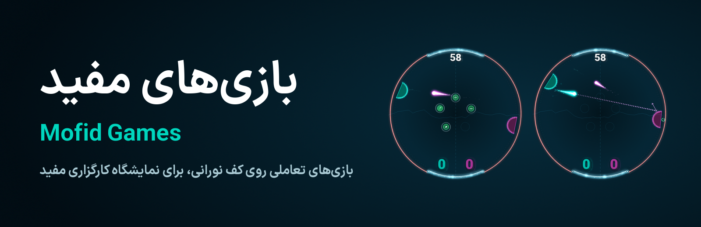
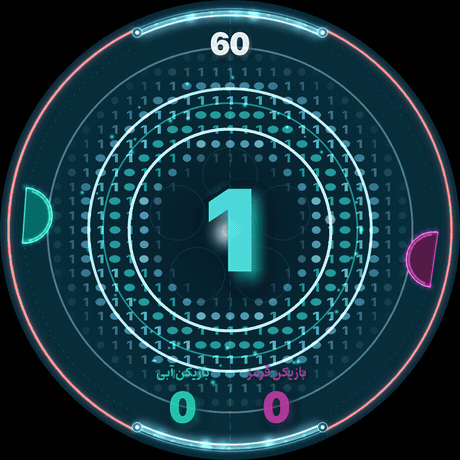

<p align="center"></p>

<p align="center">
  <a href="https://github.com/MML0/mofid-games/actions/workflows/tests.yml"></a>
  <a href="https://github.com/MML0/mofid-games/actions/workflows/build-windows.yml"></a>
  <a href="https://github.com/MML0/mofid-games/releases/latest"></a>
</p>

<p align="center"><b>The floor is the game.</b> Interactive projection-floor games for the<br>Mofid Securities (کارگزاری مفید) exhibition: walk up, step on the light and play.</p>

## The games

<table>
  <tr>
    <td width="50%" align="center">
      <a href="hocky/"></a>
    </td>
    <td width="50%" align="center">
      <br><br><br><br>
      <h3>🎮 Game two</h3>
      <i>Coming soon</i>
      <br><br><br><br>
    </td>
  </tr>
  <tr>
    <td valign="top">
      <h3><a href="hocky/">Market Hockey · هاکی بازار</a></h3>
      Air hockey made of light, for two players on a circular floor. Comet trails, ten market-themed power-ups, 240 Hz physics, Persian text throughout, and a supervisor page on your phone.
      <br><br>
      <a href="https://github.com/MML0/mofid-games/releases/latest"><b>⬇ Download for Windows</b></a> · <a href="hocky/docs/MarketHockey_Guide_FA.pdf">Player guide (فارسی)</a> · <a href="hocky/">Read more</a>
    </td>
    <td valign="top">
      The next game for the floor will live here, next to Market Hockey, with the same tests and the same one-click Windows builds.
    </td>
  </tr>
</table>

## Why build them this way

- 🖥️ **Everything an operator needs, no developer required.** Every game ships as a ready-to-run Windows folder. Settings change live from a control panel, and players' names come from a phone.
- 📡 **Any sensor can drive a game.** Games read player positions through a small input contract, so a keyboard today and a 360° LiDAR tomorrow are the same thing to the game.
- 🛡️ **Tested like it has to survive a crowd.** Every pull request and push to `main` runs the test suite on Windows and Linux. Market Hockey alone has 790+ tests at 95% coverage, and they throw corrupt files, broken sensors and every extreme setting at it.
- 🚀 **One tag, one release.** Push a version tag and GitHub Actions tests, builds, smoke-tests the real `.exe` and publishes it to [Releases](https://github.com/MML0/mofid-games/releases).

## Getting the Windows version

1. Download the zip from the [latest release](https://github.com/MML0/mofid-games/releases/latest). For an in-between build, open **Actions → Build Windows** and take it from the latest green run's *Artifacts*.
2. Unzip it anywhere writable on the Windows PC (e.g. `C:\MofidGames\MarketHockey`). Avoid `Program Files`, because settings are saved next to the `.exe`.
3. Run **`MarketHockey.exe`** (the game) and **`ControlPanel.exe`** (live settings). The first time, Windows may show *“Windows protected your PC”*: click **More info → Run anyway**.

## Developing

Each game folder has its own `README.md`, `requirements.txt` and tests.

```bash
cd hocky
python3 -m venv .venv
.venv/bin/pip install -r requirements.txt
.venv/bin/python main.py --windowed
.venv/bin/python -m pytest -q
```

| Workflow | When it runs | What it does |
|---|---|---|
| [`tests.yml`](.github/workflows/tests.yml) | every pull request and push to `main` | runs all tests on Windows and Linux |
| [`build-windows.yml`](.github/workflows/build-windows.yml) | pushes to `main` and `v*` tags | tests, builds the `.exe`, smoke-tests it, and publishes a Release for tags |

**To add a new game:** create its folder, add it to `matrix.game` in `tests.yml` and to `matrix.include` in `build-windows.yml`, and give it a `packaging/<App>.spec` file.
