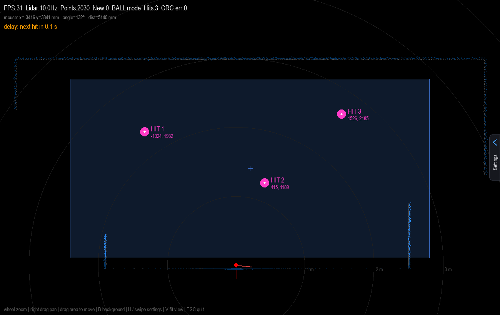
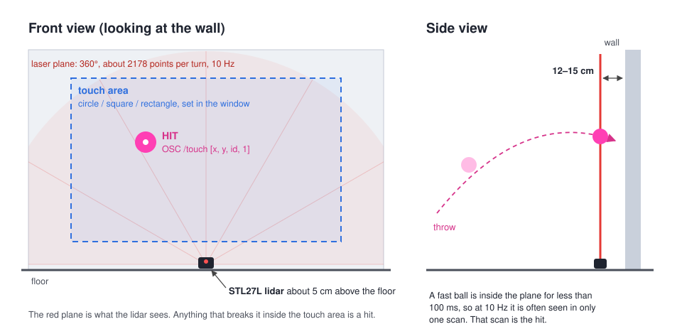
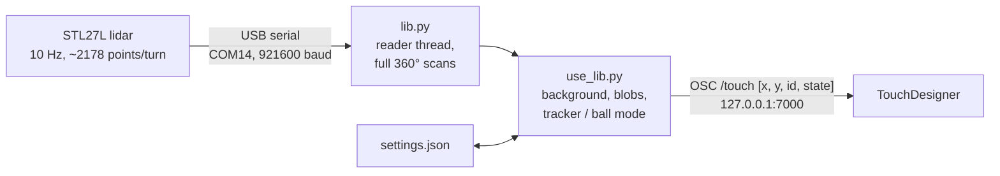
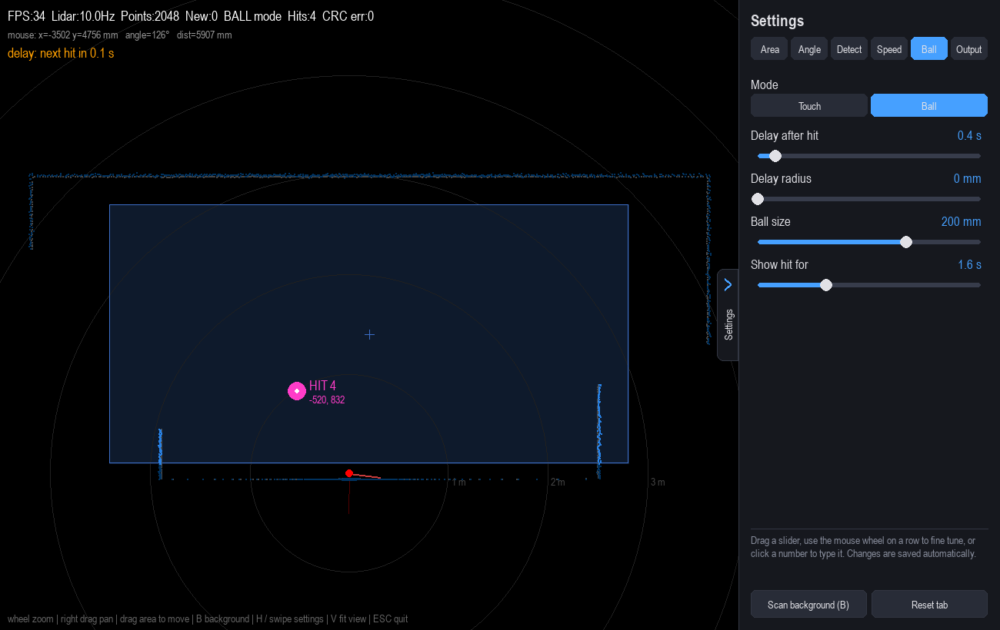
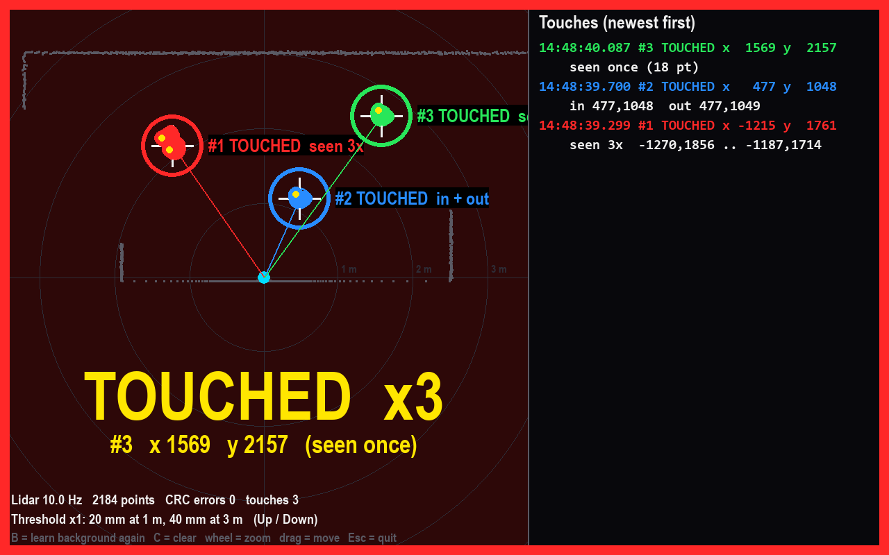
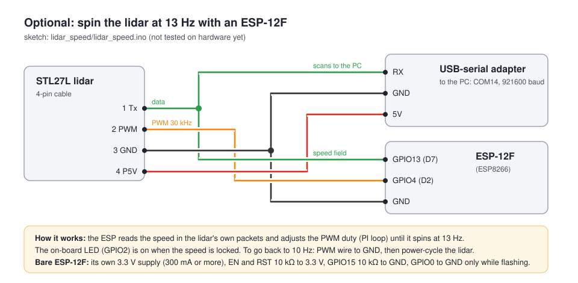

# LIdar: lidar ball-throw wall

Part of [mofid_game](../README.md). Turn a plain wall into a touch / ball-hit surface with **one 2D lidar** (LDROBOT STL27L).
The lidar scans a flat laser plane just in front of the wall. Every ball (or hand) that
breaks the plane inside the touch area is sent to **TouchDesigner** as an OSC message,
so the wall can be a game screen.



*`use_lib.py` in ball mode: room outline in blue, the touch area, and three hits with
their x, y in mm. (Screenshots in this README were made by feeding the real program a
simulated STL27L, so they show the same window you get with the sensor.)*

---

## Contents

- [Floor game: circular multiplayer paddles](#floor-game-circular-multiplayer-paddles)
- [How it works](#how-it-works)
- [Hardware](#hardware)
- [Install](#install)
- [Run](#run)
- [The window and the settings panel](#the-window-and-the-settings-panel)
- [Settings reference](#settings-reference)
- [OSC output for TouchDesigner](#osc-output-for-touchdesigner)
- [Test program: lidar_test.py](#test-program-lidar_testpy)
- [Optional: 13 Hz with an ESP-12F](#optional-13-hz-with-an-esp-12f)
- [Test results so far](#test-results-so-far)
- [Files](#files)
- [Troubleshooting](#troubleshooting)

---

## Floor game: circular multiplayer paddles

> **Connecting it to a game?** Read [docs/INTEGRATION.md](docs/INTEGRATION.md) (OSC contract, sector
> math, calibration, tests). [AGENT_PROMPT.md](AGENT_PROMPT.md) is a ready prompt for a coding agent.

`floor_game.py` is a second program for a 360° air-hockey-style floor game. Players stand
around a circle on the floor, each in their own sector. The lidar lies flat on the floor and
sees their feet. Every player gets a virtual paddle that sits **exactly on the circle** at the
player's angle, and never closer than **Border limit** (default 10°) to a dividing line, so
two paddles never meet on a border.

```bash
python floor_game.py --port COM4
```

Two windows open:

- **Game window** (`floor_game.py`): only the game. The circle and its paddles fill the window
  edge to edge (*Output > Game window edge*). Drag to move the map, wheel to zoom, `V` fit
  again, `P` show / hide the live lidar dots, `F` fullscreen, `S` reopen the setup window,
  `B` scan the empty floor, `H` show the key hint, `K` 4-point calibration, `C` fix the position
  after the lidar got bumped, `Esc` quit.
- **Setup window** (`lidar_setup.py`): the live lidar view with the game on top, and every
  setting. Changes go live to the game and are saved to `game_settings.json`.

**Changing a number precisely.** `-` and `+` move one step (hold to repeat). Click the number to
type over it: `Enter` ok, `Esc` cancel, `Up` / `Down` one step, `Tab` next number. Hold `Shift`
for a slow slider, or for 10 steps with `-`, `+` and the wheel.

**4-point calibration** (Floor game window on the LED floor, circle filling it):

1. Press `B` with the floor empty.
2. Press `K`. Four numbered yellow points appear on the floor. Put one object on each.
3. Press `A` to match them automatically (needs all 4), or drag each point onto its object's dot;
   a point dropped near a green ring sits exactly on it. Right click a point to stop using it.
4. Press `Enter`. *Rotate map*, *Lidar scale*, *Center X / Y* and, if needed, *Mirror X* are set and
   saved, and the sliders follow. The objects should now sit on the points. `U` undoes it.

If the objects block each other from the lidar, change *Arena > Calib. points turn*. Thin, straight
objects are the most exact, because the lidar sees only the side facing it.

**The lidar got bumped:** put an object on any point and press `C` (`K` first shows the points).
Only the position changes. Press `B` first if the floor is empty and the walls show as white dots.

Work through the setup tabs in order:

1. **Lidar**: all lidar calibration on one page. Keep the floor empty, press *Scan background*,
   then turn / mirror the map until it matches the room (red line = lidar 0°). White points on
   the empty floor are noise: raise *Background gap*.
2. **Arena**: drag the circle onto the play area (cross = move, edge = size) or type the
   *Diameter*. Only feet between the two thin rings are tracked.
3. **Players**, **Track**, **Paddle**, **Output**: players and sectors (drag a line's round
   handle to turn them), border limit, tracking and paddle feel, OSC options.

The game view shows only what matters: the circle (each player's color where their paddle may
go, grey in the border zones), the paddles, and the feet. A thin line from a player to their
paddle shows when they are not standing on the line.

**Tracking.** Lidar objects near the circle (inside *Track inside* / *Track outside*) are feet;
anything farther out (spectators) or deeper in is ignored. Each foot keeps an ID, also while
lifted (*Foot memory*). Feet belong to the sector they stand in (*Sector handover* stops flicker
on a line). A player's position is the mean of their feet, with a lifted foot's last spot still
counting while walking. It is filtered (alpha-beta: walking speed is predicted, so it does not
lag behind) and held / predicted while both feet are in the air (*Hold when airborne*). Feet far
from a tracked player (*Player radius*) are someone else and are ignored. A player uses at most
*Feet per player* (2) feet, the ones on the floor now and seen longest, and a foot that stands
still keeps its ID only for objects right at it (~15 cm), so a bag or another foot put down next
to a player cannot steal a foot. Things that do not move at all for *Ignore still objects*
(15 s) are ignored until they move. When the player jumps or runs to another spot (their old
spot is empty and new feet land elsewhere in the sector), the player and the paddle teleport
there at once; feet that were already standing there are someone else and are not taken. A gap
of more than *Teleport from* (800 mm) also snaps instead of gliding; 0 = always glide. While
running, a foot that just landed is used at once. The paddle is
smoothed strongly while the player stands still and lightly while they move.

**OSC** to `127.0.0.1:7000`, every frame (60 Hz):

```
/paddle [player, x, y, angle, active, confidence]
/foot   [id, x, y, player]            only with Lidar > Send feet
```

`x`, `y` in mm (or 0..1 in the arena box with *Send 0..1*), `angle` in degrees around the
arena center (0 = right, counter-clockwise), `active` 1 while the player is tracked.

**Record and replay** a session for tuning without people on the floor:

```bash
python floor_game.py --port COM4 --record session.pkl
python floor_game.py --replay session.pkl
```

The two windows talk over local UDP (ports 7011 / 7012, JSON). The touch / ball program below
is unchanged and keeps its own `settings.json`.

## How it works





1. **Background.** With the area empty, the program scans for a few seconds and stores the
   closest stable distance for every 0.25° slice (a polar background, not an x/y grid).
2. **New points.** A point is *new* when it is clearly closer than the background at its
   angle (something blocks the beam) and it is inside the touch area.
3. **Blobs.** New points are grouped in scan order into objects (hand, ball).
4. **Tracking.**
   - **Touch mode:** an object must be seen a few scans in a row before TOUCH DOWN. It moves
     with smoothing (One Euro filter) and gets TOUCH UP after a short time without it.
   - **Ball mode:** the **first scan** that sees a new object is the hit. Its x, y are frozen
     (no MOVE events). New hits are then blocked for *Delay after hit*. A ball that is still
     seen (falling, rolling) cannot make a new hit near it.

Every scan is processed, not only the newest one. A fast ball is often in just one scan.

## Hardware

| Part | Notes |
|---|---|
| **LDROBOT STL27L** 2D lidar | The code calls it `D800`. 10 Hz, about 2178 points per turn, 921600 baud. |
| USB-serial adapter | Shows up as **COM14** on the dev PC (change it with `--port`). |
| PC with Python 3.10+ | Runs the detector. TouchDesigner can be on the same PC or another one. |
| Ball | 10–15 cm balls were used in the tests. |
| ESP-12F (ESP8266), optional | Only for the 13 Hz speed mod, see [below](#optional-13-hz-with-an-esp-12f). |

**Mounting:** put the lidar near the floor, with its laser plane parallel to the wall and
**about 12–15 cm in front of it** (closer planes missed more fast throws in tests). In the
map, y points up and the floor is a line just below the lidar. `use_lib.py` uses points up
to 5 m from the lidar.

## Install

```bash
pip install -r requirements.txt
```

Tested with Python 3.10, numpy 2.2, pygame 2.6, pyserial 3.5, python-osc 1.10.

## Run

```bash
python use_lib.py
```

1. Keep the laser plane **empty** while the background is learned (15 s with the current
   `settings.json`). A countdown is shown.
2. Open the settings panel (`H`, click the **Settings** tab on the right edge, or swipe) and
   set the area, the mode and so on. Every change is saved to `settings.json` right away.
3. Throw or touch. Hits go out as OSC.

Command line options:

| Option | What it does |
|---|---|
| `--port COM5` | Serial port of the lidar (default `COM14`). |
| `--headless` | No window; print touches in the console. Uses the same `settings.json`. |
| `--time 60` | With `--headless`: stop after 60 s. |
| `--no-osc` | Do not send OSC. |
| `--settings my.json` | Use another settings file. |

## The window and the settings panel



| Key / mouse | Action |
|---|---|
| `H`, click the side tab, or swipe | Open / close the settings panel |
| `B` | Scan the background again (keep the area empty) |
| `V` | Fit the whole background in the view again |
| Mouse wheel, `Up` / `Down` | Zoom |
| Right drag | Pan the map |
| Left drag inside the area | Move the touch area |
| `Esc` | Quit |

The top line shows FPS, lidar speed (Hz), points per scan, new points, the mode and number
of hits, and CRC errors. In ball mode an orange line shows when the next hit is allowed.

## Settings reference

All values are changed live in the panel and saved to `settings.json`. The defaults below
are the code defaults (`settings.py`). The file in this repo holds the values tuned on site.

<details>
<summary><b>Area</b>: where hits count</summary>

| Setting | Key | Default | Meaning |
|---|---|---|---|
| Shape | `shape` | circle | circle, square or rectangle. Only hits inside count. Drag it on the map to move it. |
| Center X / Y | `area_x`, `area_y` | 0, 0 mm | Position of the area. |
| Radius | `radius` | 3000 mm | Circle only. |
| Size | `size` | 2000 mm | Square only: side length. |
| Width / Height | `width`, `height` | 1600 / 900 mm | Rectangle only: set them to the projected screen. |
</details>

<details>
<summary><b>Angle</b>: lidar mounting</summary>

| Setting | Key | Default | Meaning |
|---|---|---|---|
| Rotate view | `rotation` | 0° | Turn all points so the wall lines up with the map axes (lidar mounted at an angle). |
| Angle from / to | `angle_from`, `angle_to` | 0° / 360° | Only count hits between these angles (counter-clockwise, 0° = right). |
| Min distance | `min_distance` | 100 mm | Ignore everything closer to the lidar (cover, frame, cables). |
</details>

<details>
<summary><b>Detect</b>: what counts as an object</summary>

| Setting | Key | Default | Meaning |
|---|---|---|---|
| Background gap | `bg_margin` | 40 mm | How far in front of the background a point must be to be new. Below ~25 mm, lidar noise makes false touches. |
| Extra gap far away | `bg_margin_ratio` | 2 % | Adds this % of the distance (noise grows with distance). |
| Smallest object | `min_width` | 15 mm | Thinner objects are noise. Use ~30 mm for balls to drop single-point noise. |
| Biggest object | `max_width` | 600 mm | Bigger objects (body, chair) are ignored. |
| Join distance | `cluster_distance` | 100 mm | Points closer than this are one object. Too low splits a hand into fingers. |
| Same hand radius | `touch_spacing` | 150 mm | A new object this close to a touch is the same hand. |
| Background scan time | `calibration_time` | 10 s | How long the empty area is scanned. |
</details>

<details>
<summary><b>Speed</b>: touch timing and smoothing</summary>

| Setting | Key | Default | Meaning |
|---|---|---|---|
| Touch down after | `confirm_scans` | 2 scans | Touch mode: scans in a row before TOUCH DOWN. Ball mode always uses 1. |
| Touch up after | `release_time` | 0.25 s | How long a touch may vanish and keep its ID (min 0.15 s). |
| Max jump | `match_distance` | 300 mm | How far a touch may move between two scans. |
| Smooth when still | `smooth_min_cutoff` | 1.0 Hz | Lower = steadier when still, more lag. |
| Follow fast moves | `smooth_beta` | 0.010 | Higher = less lag on fast moves. |
</details>

<details>
<summary><b>Ball</b>: ball-throw mode</summary>

| Setting | Key | Default | Meaning |
|---|---|---|---|
| Mode | `mode` | touch | `touch` follows hands; `ball` gives one hit per throw at the first x, y seen. |
| Delay after hit | `hit_delay` | 1.0 s | New hits are ignored for this long (bounce, roll, fall). |
| Delay radius | `hit_radius` | 0 mm | 0 = the delay blocks the whole area; above 0 only near the last hit (several players). |
| Ball size | `ball_size` | 0 mm | The lidar sees the front of the ball; the hit is moved back by half of this. |
| Show hit for | `show_hit` | 0.5 s | How long a hit stays on the map (window only, OSC is not changed). |
</details>

<details>
<summary><b>Output</b>: coordinates and drawing</summary>

| Setting | Key | Default | Meaning |
|---|---|---|---|
| Mirror X / Y | `flip_x`, `flip_y` | off | Mirror the map if it looks mirrored compared with the room. |
| Send 0..1 | `normalize` | off | Send x, y from 0 to 1 inside the area box (0, 0 = bottom left) instead of mm. |
| Show lidar points | `show_points` | on | Draw all lidar points (blue = inside the area). |
| Show background | `show_background` | on | Draw the learned background (grey). |
</details>

## OSC output for TouchDesigner

```
/touch  [x, y, id, state]
```

| Field | Meaning |
|---|---|
| `x`, `y` | Position in mm on the map, or 0..1 inside the area with **Send 0..1** |
| `id` | Touch / hit number |
| `state` | `1` = down / hit, `0` = move (touch mode only), `-1` = up / gone |

The target is `127.0.0.1:7000` (`OSC_IP` and `OSC_PORT` at the top of `use_lib.py`). In
TouchDesigner, an **OSC In CHOP** or **OSC In DAT** on port 7000 receives it.

## Test program: lidar_test.py



A separate, simple test program. It does not use or change the main program or its settings.

- Learns the background for 10 s, then every point closer than the background counts, even
  a single point. Nothing is filtered; points are drawn big.
- A thrown ball can be seen twice: on the way in and on the way back. After the first
  sighting it waits 0.25 s, then shows **TOUCHED** once at the middle of all sightings
  (*in only*, *out only*, or *in + out*).
- Keys: `B` learn the background again, `C` clear the list, `Up` / `Down` change the
  threshold (lowest = off, raw), mouse wheel zoom, drag to move, `Esc` quit.

```bash
python lidar_test.py --port COM14
```

## Optional: 13 Hz with an ESP-12F

At 10 Hz the lidar looks at each spot once every 100 ms, and a fast ball can cross the plane
between two looks. The STL27L can spin faster when its PWM wire is driven.
`lidar_speed/lidar_speed.ino` holds it at **13 Hz** with a PI loop on the speed field in the
lidar's own packets, as the STL27L manual asks.



- Board: Generic ESP8266 or NodeMCU 1.0 in the Arduino IDE (esp8266 core 3.1.2).
- PWM on GPIO4 (D2) at 30 kHz; lidar data read on GPIO13 (D7) via `Serial.swap()`; Wi-Fi off.
- Check: `use_lib.py` should show `Lidar: ~13.0Hz` and about 1660 points; press `B` to scan
  the background again.

> **Status:** the sketch compiles but has **not been tested on hardware yet**.

## Test results so far

- At 10 Hz the sensor gave about 2178 points per turn and 0 CRC errors.
- **Fast throws that were missed came from the sampling rate, not the software.** A replay
  showed no ball dropped by filters or the delay.
- Moving the laser plane about 12–15 cm off the wall: **8 of 10 fast throws caught**, each
  seen in exactly one scan.
- 2 false hits came from single noise points at the 3 m edge of the area. Fix: Detect >
  Smallest object 30 mm, or a smaller / rectangle area.
- Next step: the 13 Hz ESP mod, then 10 fast throws again to compare with 8 / 10.

## Files

| File | What it is |
|---|---|
| [`floor_game.py`](floor_game.py) | Circular floor game: lidar engine, game window, OSC, record / replay. |
| [`lidar_setup.py`](lidar_setup.py) | Setup window: live lidar view, arena editor, all settings. |
| [`game_view.py`](game_view.py) | Drawing shared by the game and setup windows. |
| [`link.py`](link.py) | Local UDP link between the two windows. |
| [`docs/INTEGRATION.md`](docs/INTEGRATION.md) | How to connect the floor game lidar to a game (OSC, sectors, calibration, settings). |
| [`AGENT_PROMPT.md`](AGENT_PROMPT.md) | Prompt for a coding agent that adds the lidar to the game. |
| [`tests/`](tests) | `test_tracker.py` scenario tests, `test_replay.py` full pipeline on a recording. |
| [`tools/osc_monitor.py`](tools/osc_monitor.py) | Prints the OSC the floor game sends. |
| [`samples/`](samples) | A real 95 s session and its settings, for replay without hardware. |
| [`feet_tracker.py`](feet_tracker.py) | Foot IDs, sector ownership, player filter, paddle on the circle (no drawing). |
| [`game_settings.py`](game_settings.py) | Floor game settings and arena geometry; saved to `game_settings.json`. |
| [`use_lib.py`](use_lib.py) | Main program: background, detection, touch / ball tracking, window, OSC. |
| [`lib.py`](lib.py) | STL27L driver: reads the serial port in a thread and builds full 360° scans (CRC checked). |
| [`settings.py`](settings.py) | All tunable values, their ranges and help text; load / save `settings.json`. |
| [`settings_ui.py`](settings_ui.py) | The sliding settings panel (tabs, sliders, typed numbers, swipe). |
| [`settings.json`](settings.json) | Current tuned values (written by the panel). |
| [`lidar_test.py`](lidar_test.py) | Stand-alone raw test program (see above). |
| [`lidar_speed/lidar_speed.ino`](lidar_speed/lidar_speed.ino) | ESP-12F sketch for 13 Hz. |
| [`chat_summary.md`](chat_summary.md) | Working notes: setup, findings and next steps. |
| [`docs/images/`](docs/images) | Screenshots and diagrams used in this README. |

## Troubleshooting

| Problem | Fix |
|---|---|
| `Waiting for lidar USB...` | Wrong port, or another program has it open. Only **one** program can open the port: close `use_lib.py` / `lidar_test.py` first. Use `--port`. |
| False hits in an empty area | Press `B` with the area empty. Raise **Smallest object** (~30 mm for balls) or **Background gap**, or make the area smaller. |
| Fast throws missed | Move the plane 12–15 cm off the wall. Try the 13 Hz mod. |
| Map is mirrored or tilted | **Output > Mirror X / Y** and **Angle > Rotate view**. |
| One hand gives two touches | Raise **Join distance** or **Same hand radius**. |
| Nothing arrives in TouchDesigner | Check port 7000 and `OSC_IP`, and that `--no-osc` is not set. |
