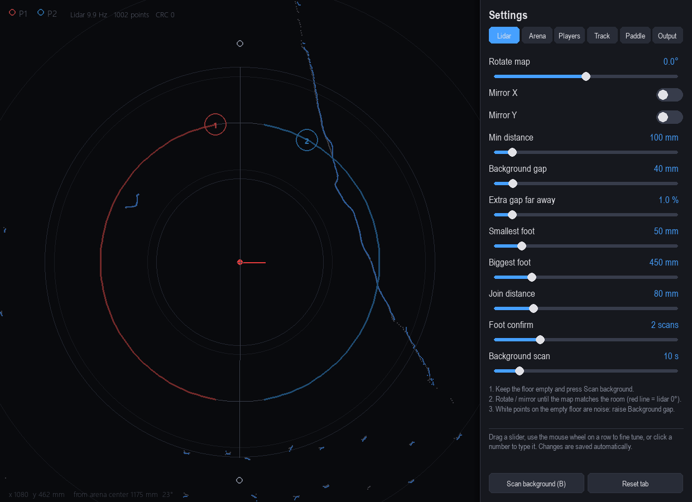
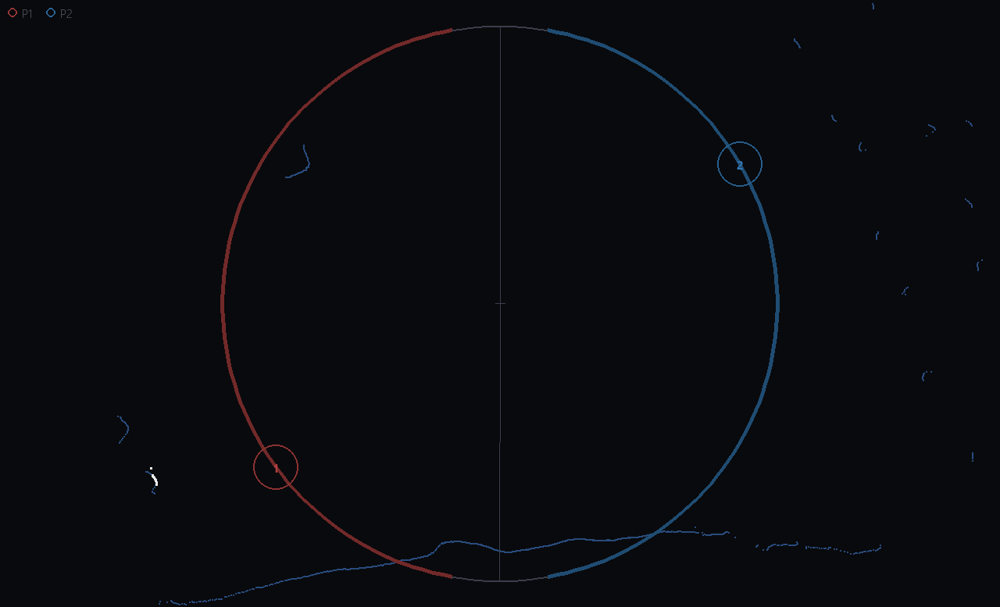

# Floor game lidar: integration guide

This folder is a finished, tested **input device** for a circular, multiplayer, air-hockey-style
floor game. One 2D lidar (LDROBOT STL27L) lies on the floor and sees the players' feet. The
program turns the feet into **one virtual paddle per player** that sits exactly on the game
circle, and sends the paddles to the game over **OSC (UDP)**.

The game itself (puck, physics, scoring, rendering) is **not** in this folder. To connect a game,
you **listen to OSC** and move the game's paddles. You don't need to change any lidar code.

---

## 1. The game concept (what this was built for)

- A circular arena on the floor, with spectators all around (360°).
- 1 to 8 players stand around the circle. Each one owns a **sector**, and the sectors are split
  by dividing lines.
- Players move their paddle with their **feet** by walking along their part of the circle.
- A shared puck is hit across the arena, and players try to score in the other players' zones.
- A paddle never goes closer than the **Border limit** (default 10°) to a dividing line, so two
  paddles can't collide on a border.
- A paddle is always **on the circle line**, even when the player stands a bit inside or outside
  it. The paddle sits at the player's angle.

---

## 2. Architecture

```
STL27L lidar --USB serial--> floor_game.py (engine, owns the COM port)
                               |  background -> feet -> players -> paddles
                               |-- OSC /paddle, /foot --> THE GAME (UDP 127.0.0.1:7000)
                               |-- game window: preview of the arena (optional)
                               '-- UDP JSON 7011/7012 <--> lidar_setup.py (setup window)
```

| File | Role |
|---|---|
| `floor_game.py` | **Entry point.** Lidar engine, game preview window, OSC sender, record / replay. |
| `lidar_setup.py` | Setup window: live lidar view, arena editor (drag the circle / lines), all settings. Opened by `floor_game.py`. |
| `feet_tracker.py` | The algorithm: foot IDs, sector ownership, player filter, paddle on the circle. Pure logic, no I/O. |
| `calibration.py` | 4-point calibration (key `K` in the game window): works out rotation, lidar scale, center and mirror. |
| `game_settings.py` | Every setting (default, range, help) plus the arena geometry. Saved to `game_settings.json`. |
| `game_settings.json` | The calibration in use. **Written by the setup window; read by the engine.** |
| `game_view.py` | Drawing shared by both windows. |
| `link.py` | Local UDP link between the engine and the setup window (JSON, no pickle). |
| `lib.py` | STL27L serial driver: reader thread, full 360° scans, CRC check. |
| `use_lib.py` | Background model and blob detector (shared with the older touch / ball program). |
| `settings.py`, `settings_ui.py` | Settings framework and the slider panel. |
| `tests/` | `test_tracker.py` (scenario tests), `test_replay.py` (full pipeline on a recording), `test_calibration.py` (scale, 4-point calibration, number controls). |
| `tools/osc_monitor.py` | Prints the OSC the engine sends. Use it to check an integration. |
| `samples/` | A real 95 s recording (2 players' worth of walking) and the settings it was tuned with. |

`lidar_test.py`, `settings.json` and the touch / ball mode of `use_lib.py` belong to an older ball-throw
wall project that shares the driver. They are not needed for the floor game.

**Recommended integration: keep the engine as a separate process and talk to it only through OSC.**
That works the same for any game engine (Unity, Godot, Unreal, TouchDesigner, a web app through a
bridge, or Python). Only one program can open the lidar's COM port, and that program is the engine.

---

## 3. OSC output (the contract)

The engine sends to `--osc-ip` / `--osc-port` (default `127.0.0.1:7000`), **every frame (~60 Hz)**,
one message **per player**, also for players who aren't there:

```
/paddle  [player:int, x:float, y:float, angle:float, active:int, confidence:float]
```

| Arg | Meaning |
|---|---|
| `player` | 1..N, the sector index (see §4). Player 1 is the sector that starts at the first dividing line, then counter-clockwise. |
| `x`, `y` | Paddle center in **mm** on the lidar map (lidar = 0,0; +x right, +y up, as drawn in the setup window). With *Output > Send 0..1* on, it is 0..1 inside the circle's bounding box instead, where (0,0) is bottom-left, so flip y for screen coordinates. Always exactly on the circle. |
| `angle` | Paddle angle in **degrees** around the arena center, 0 = +x (right), counter-clockwise, 0..360. Already clamped to the sector minus the border limit. |
| `active` | 1 = a player is tracked in this sector (feet seen, or held briefly while jumping). 0 = nobody there: the paddle stays parked at its last spot. |
| `confidence` | 0..1, rises over ~0.3 s of steady feet and falls while no foot is seen. Optional: use it to fade the paddle. |

Optional, with *Output > Send feet* on:

```
/foot  [id:int, x:float, y:float, player:int]     every confirmed foot in the tracking ring, every frame
```

`player` is the sector the foot stands in. The foot isn't necessarily one the player uses (a bystander's
foot in that sector is sent too), so drive paddles from `/paddle`, not from `/foot`.

**Easiest robust mapping in a game:** ignore `x, y` and use the **angle** alone:

```
paddle_position = game_arena_center + game_arena_radius * (cos(angle), sin(angle))
```

This way the game's own arena size and units don't matter. If the projected image is mirrored
compared with the floor, use `angle' = 180 - angle` (horizontal mirror) or `angle' = -angle`
(vertical mirror). A rotation is `angle' = angle + offset`. Make the mirror and the offset settings in the game.

Timing: the lidar scans at 10 Hz. The engine predicts and smooths in between and sends at 60 Hz, so the
game can apply OSC values directly, with no extra smoothing. End-to-end delay is about 0.1–0.2 s.

---

## 4. Sectors (so the game's goals match the lidar's players)

The game must use **the same sector layout** as the engine, or player 2's goal ends up in the wrong place.
The layout lives in `game_settings.json`:

```
n          = players
sizes      = [360/n] * n                         if equal_sectors
           = sector_1..sector_n scaled to sum 360  otherwise
start[0]   = line_angle
start[k]   = start[k-1] + sizes[k-1]
player k+1 owns angles [start[k], start[k] + sizes[k])   (degrees, CCW, 0 = +x)
paddle k+1 is clamped to [start[k] + gap, start[k] + sizes[k] - gap],  gap = min(border_gap, sizes[k] / 2)
```

`GameSettings.sectors()` in `game_settings.py` is the reference implementation. A game can read
`game_settings.json` at start (and when the file changes), or the values can be copied into the
game's config. Default: 2 players, `line_angle` 90°, so P1 = left half (90°..270°) and P2 = right
half (270°..450°).

---

## 5. Running it

```bash
pip install -r requirements.txt                  # numpy, pygame, pyserial, python-osc
python floor_game.py --port COM4                 # lidar on COM4, OSC to 127.0.0.1:7000
python floor_game.py --port COM4 --osc-ip 192.168.1.20 --osc-port 9000
python floor_game.py --port COM4 --headless      # no windows (a service on the game PC)
python floor_game.py --replay samples/session_2players.pkl --settings samples/session_2players.settings.json --loop
```

| Option | What it does |
|---|---|
| `--port COMx` | Lidar serial port (Windows Device Manager > Ports, "CP210x"). |
| `--osc-ip`, `--osc-port` | Where the game listens. |
| `--headless` | No windows; prints the paddles once per second. |
| `--no-setup` | Game window without the setup window. |
| `--no-osc` | Don't send OSC. |
| `--settings file.json` | Another settings file. |
| `--record file.pkl` | Also save every raw scan (for tuning without people). |
| `--replay file.pkl` / `--loop` | Use a recording instead of the lidar (real time). **Use this to develop the game without hardware.** |
| `--time N` | Stop after N seconds. |

At start the engine scans the **empty floor** for 10 s, so keep the circle clear.

**Game window keys:** drag = move the map, wheel = zoom, `V` fit, `P` live lidar dots on / off,
`F` fullscreen, `S` reopen the setup window, `B` scan the empty floor again, `H` key hint, `Esc` quit.





**Setup window:** the live lidar view (blue = all points, white = possible feet, grey = background),
the arena on top, and the settings on the right. Drag the center cross to move the arena, the circle
edge to set the diameter, and a round handle to turn the dividing lines. Every change goes live and is saved.

---

## 6. On-site calibration (in this order)

1. Lay the lidar flat on the floor, plane at ankle height, with a clear view of the whole circle.
2. `python floor_game.py --port COMx`. Keep the floor empty for the 10 s scan.
3. **Lidar tab:** *Rotate map* and *Mirror X / Y* until the map matches the room (the red line is
   the lidar's 0°). If white points show on the empty floor, raise *Background gap* or *Smallest foot*.
   Press *Scan background* after moving anything.
4. **Arena:** with the game window on the floor display, press `K`, put an object on each of the 4
   points, press `A` (or drag each point onto its object's dot), then `Enter`. This sets rotation,
   lidar scale, center and mirror; the circle's *Diameter* is not changed. Set *Track inside / outside*
   to how far from the line players really stand. If the lidar is bumped later: one object on a point, `C`.
5. **Players tab:** number of players, *Line rotation* so the dividing lines match the game's
   goals, *Border limit*.
6. **Track / Paddle tabs:** only if it feels laggy or jumpy (see the table below).
7. The game must use the same sector layout (§4) and map `angle` onto its own circle (§3).

The `game_settings.json` in this folder is the calibration of the test room (rotation 85°, mirror X,
2.17 m circle about 1.7 m from the lidar). **Redo steps 2–5 on site.**

---

## 7. How the tracking works (short)

1. **Background:** the empty floor is learned as one distance per 0.25° slice. A point clearly in
   front of it is "new".
2. **Feet:** new points inside the tracking ring (circle ± *Track inside/outside*) are grouped into
   blobs. Blobs narrower than *Smallest foot* or wider than *Biggest foot* are dropped, so spectators
   and the middle of the arena are ignored.
3. **Foot IDs:** blobs are matched to feet between scans. A still foot keeps its ID only for objects
   within ~15 cm, so a bag or someone else's foot put next to it can't steal the ID. A lifted foot keeps
   its ID and last spot for *Foot memory*. Objects that don't move at all for *Ignore still objects* are ignored.
4. **Sectors:** each foot belongs to the sector it stands in. *Sector handover* adds hysteresis on the
   dividing lines.
5. **Player:** at most *Feet per player* feet (the ones on the floor now, then the ones seen longest),
   within *Player radius* of the player. Position = mean of the feet, with a lifted foot's last spot still
   counting while walking. An alpha-beta filter predicts walking speed, so the paddle doesn't trail behind.
   With no foot seen (jump in place), the position is held and predicted for *Hold when airborne*.
   **Teleport:** when the player's old spot is empty and new feet land elsewhere in the sector (a jump
   or a run to another place), the player moves there at once, without waiting for the hold time. Feet
   that were already standing there (another person, an object, also one that blinks out and back)
   are not taken. Feet that land more than *Teleport from* away from the estimate also snap. While
   running, a foot that just landed is used on the same scan, before it is confirmed, and a lifted
   foot left far behind (more than *Player radius* from the standing feet) stops counting.
6. **Paddle:** the player's angle around the arena center, clamped by the border limit, smoothed
   (strongly when standing, lightly when moving), speed limited, and placed exactly on the circle.
   When the paddle is more than *Teleport from* behind the player (or the player teleported), it jumps
   there in one frame instead of gliding. *Teleport from* = 0 restores the old glide everywhere.

### Settings reference

All of these are in the setup window, saved to `game_settings.json`.

**Lidar**

| Setting | Key | Default | Range | What it does |
|---|---|---|---|---|
| Rotate map | `rotation` | 0.0° | -180..180 ° | Turn all lidar points so the map matches the room. |
| Lidar scale | `lidar_scale` | 1.000 | 0.5..2 | Makes the whole lidar map bigger or smaller around the lidar, without changing the arena circle. Set by the 4-point calibration. |
| Mirror X | `flip_x` | false |  | Swap left and right (lidar mounted upside down). |
| Mirror Y | `flip_y` | false |  | Swap down and up. |
| Min distance | `min_distance` | 100 mm | 0..1000 mm | Ignore everything closer than this to the lidar (its cover, cables). |
| Background gap | `bg_margin` | 40 mm | 10..300 mm | A point must be this much in front of the empty-floor scan to count. Raise it if white points show on the empty floor. |
| Extra gap far away | `bg_margin_ratio` | 1.0 % | 0..10 % | Adds this % of the distance to the gap (noise grows with distance). |
| Smallest foot | `min_width` | 50 mm | 5..300 mm | Narrower objects are ignored (noise, cables, bottles, table legs). Feet are about 100-170 mm wide to the lidar. |
| Biggest foot | `max_width` | 450 mm | 50..2000 mm | Bigger objects (bag, chair) are ignored. Two feet close together can look like one ~400 mm object. |
| Join distance | `cluster_distance` | 80 mm | 20..300 mm | Points closer than this are one foot. Too high joins both feet. |
| Foot confirm | `foot_confirm` | 2 scans | 1..5 scans | A new foot must be seen this many scans in a row (0.1 s each). Higher = less noise, slower to start. |
| Background scan | `calibration_time` | 10 s | 2..60 s | How long the empty floor is scanned (Scan background / B). |

**Arena**

| Setting | Key | Default | Range | What it does |
|---|---|---|---|---|
| Diameter | `diameter` | 4000 mm | 600..10000 mm | Diameter of the game circle. Paddles always sit on this line. You can also drag the circle on the map. |
| Center X | `center_x` | 0 mm | -5000..5000 mm | Arena center, left / right of the lidar. You can also drag the center cross on the map. |
| Center Y | `center_y` | 0 mm | -5000..5000 mm | Arena center, down / up of the lidar (or drag the cross). |
| Track inside | `band_in` | 600 mm | 0..3000 mm | Feet up to this far INSIDE the circle belong to a player. Anything deeper inside is ignored. |
| Track outside | `band_out` | 600 mm | 0..3000 mm | Feet up to this far OUTSIDE the circle belong to a player. Anything farther out (spectators) is ignored. |
| Paddle size | `paddle_size` | 250 mm | 50..800 mm | Paddle diameter. Drawing only; the game decides collisions. |

**Players**

| Setting | Key | Default | Range | What it does |
|---|---|---|---|---|
| Players | `players` | 2 | 1..8 | Number of players. Each one owns one sector of the circle. |
| Line rotation | `line_angle` | 90.0° | -180..180 ° | Angle of the first dividing line (0° = right, counter-clockwise). Turns all sectors together. You can also drag a line's handle. |
| Border limit | `border_gap` | 10.0° | 0..45 ° | A paddle stays at least this far from a dividing line, so two paddles never meet on a border. |
| Equal sectors | `equal_sectors` | true |  | On: all sectors are the same size. Off: set each size below (they are scaled to fill 360°). |
| Sector P1 .. P8 | `sector_1 .. sector_8` | 90° | 10..350 ° | Size of this player's sector. The sizes are scaled so they fill the whole circle. |

**Track**

| Setting | Key | Default | Range | What it does |
|---|---|---|---|---|
| Foot max step | `foot_match` | 400 mm | 50..1500 mm | How far a foot may move between two scans and keep its ID. |
| Foot memory | `foot_keep` | 0.50 s | 0.1..3 s | A lifted foot keeps its ID and last spot this long. Covers walking steps and one foot hidden behind the other. |
| Feet per player | `feet_per_player` | 2 | 1..4 | A player uses at most this many feet: the ones on the floor now, then the ones seen longest. Extra objects next to a player (a bag, someone else's foot) are ignored. |
| Player radius | `player_radius` | 700 mm | 200..2000 mm | Feet farther than this from the player are someone else and are ignored while the player is tracked. |
| Hold when airborne | `hold_time` | 1.0 s | 0.1..5 s | With no foot seen (jump, hidden) the player is predicted and held this long before the paddle is released. |
| Prediction fade | `predict_time` | 0.30 s | 0..2 s | While no foot is seen the last movement continues and fades out over this time. 0 = stop at once. |
| Sector handover | `owner_hold` | 5.0° | 0..30 ° | A foot must be this far over a dividing line before it belongs to the next player (no flicker on the border). |
| Ignore still objects | `still_ignore` | 15 s | 0..120 s | Something that does not move at all for this long (bag, bottle, chair put down after the background scan) is ignored until it moves. 0 = off. Press B to make it part of the background. |

**Paddle**

| Setting | Key | Default | Range | What it does |
|---|---|---|---|---|
| Teleport from | `jump_distance` | 800 mm | 0..3000 mm | When the feet show up this far from where the player was (a jump, a fast run, a new player), the player and the paddle go there at once instead of gliding. Feet outside the Player radius while the old spot is empty always teleport. Keep it above half a running stride (~700 mm) or the paddle hops each step. 0 = always glide (old behaviour). |
| Correction speed | `correction_time` | 0.12 s | 0..2 s | How fast the player position follows the feet. Lower = faster, higher = smoother. |
| Reacquire speed | `reacquire_time` | 0.40 s | 0..3 s | After the feet were lost, how gently the position moves to the new feet (no jump). |
| Lifted foot weight | `lifted_weight` | 1.00 | 0..1 | How much a lifted foot's last spot still counts when only one foot is on the floor (walking). 1 = the player is between both feet, 0 = follow the standing foot only. |
| Confidence build | `confidence_time` | 0.30 s | 0.05..3 s | Time of steady feet until the player counts as fully tracked. |
| Smoothing standing | `still_lag` | 0.25 s | 0..1.5 s | Paddle smoothing while the player stands still. Higher = steadier paddle, no jitter. |
| Smoothing moving | `paddle_lag` | 0.05 s | 0..1 s | Paddle smoothing while the player moves fast. Lower = less lag. |
| Fast move from | `moving_speed` | 600 mm/s | 50..3000 mm/s | From this walking speed on the 'moving' smoothing is used; slower moves blend toward the 'standing' smoothing. |
| Paddle max speed | `paddle_speed` | 4000 mm/s | 200..20000 mm/s | The paddle never moves faster than this along the circle (no sudden jumps). |
| Prediction lead | `lead` | 0.05 s | 0..0.5 s | Move the paddle this far ahead along the walking direction to hide the lidar's 0.1 s delay. |

**Output**

| Setting | Key | Default | Range | What it does |
|---|---|---|---|---|
| Send 0..1 | `normalize` | false |  | Send x, y from 0 to 1 inside the arena box (0, 0 = bottom left) instead of mm. |
| Send feet | `send_feet` | false |  | Also send every foot as /foot [id, x, y, player]. |
| Lidar dots in game | `game_dots` | false |  | Show the live lidar points in the game window too (blue = all points, white = possible feet). P in the game window does the same. |
| Game window edge | `game_margin` | 1.0 % | 0..30 % | Space between the circle (with its paddles) and the game window edge. 0 = the circle touches the edges. |

---

## 8. Testing without people or hardware

```bash
python tests/test_tracker.py        # 29 scenario tests of the algorithm, exit code 0 = pass
python tests/test_replay.py         # full pipeline on samples/, checks paddles stay on the circle and out of the border zones
python tools/osc_monitor.py 7005    # in one terminal: prints /paddle lines
python floor_game.py --headless --replay samples/session_2players.pkl --settings samples/session_2players.settings.json --osc-port 7005 --loop
```

Replaying the sample sends real `/paddle` traffic (P1 walking in the left half, later P2 on the right),
so a game integration can be built and tested on a laptop with no lidar. Only one program can listen on
a UDP port, so stop the monitor before the game listens on the same port.

---

## 9. Limits and tips

- 10 Hz scan rate: very fast stomps between two scans are smoothed, not missed. The paddle trails a fast
  walk by a few degrees at most (tested up to 1.5 m/s).
- One lidar at ankle height: a person standing between the lidar and another player hides them. Put the
  lidar where nobody can stand in front of it (e.g. at the arena center, or outside the circle with a clear
  view). Held / predicted positions bridge short hides (*Hold when airborne*).
- A player standing completely still for longer than *Ignore still objects* (15 s) loses the paddle until
  they move. Raise it, or set it to 0, if that matters for the game.
- After moving furniture, scan the background again (`B`, or *Scan background*) with the floor empty.
- Only one program can open the COM port. Close other lidar tools first.
- Ports used: 7000 (OSC out, configurable), 7011 / 7012 (engine <-> setup window, localhost only).
- Tested on Windows 11, Python 3.12, pygame 2.6, numpy 2.x, pyserial 3.5, python-osc 1.10.
