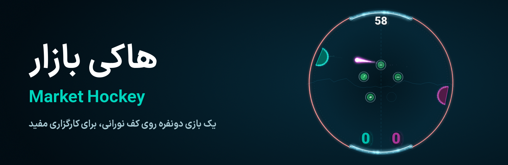
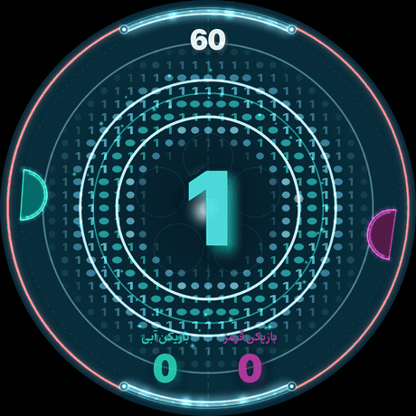
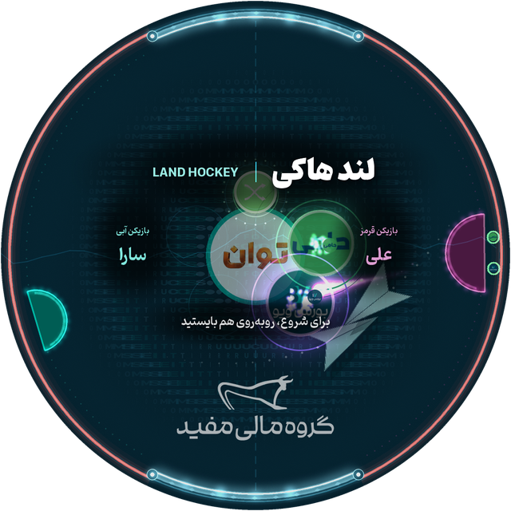
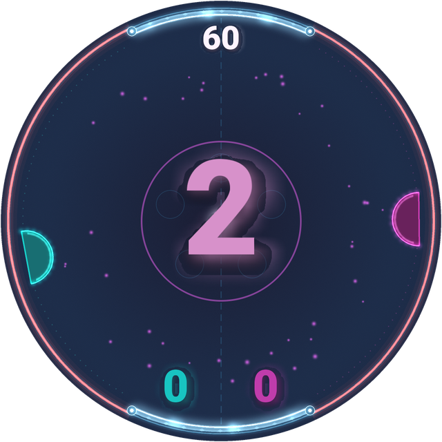
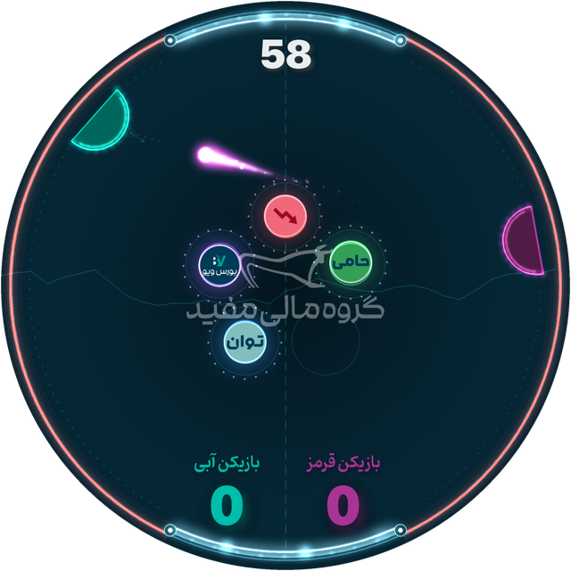
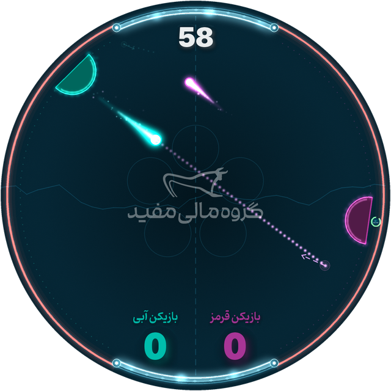
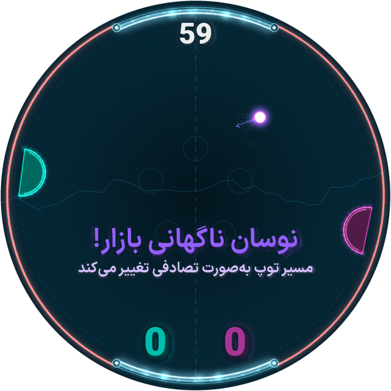
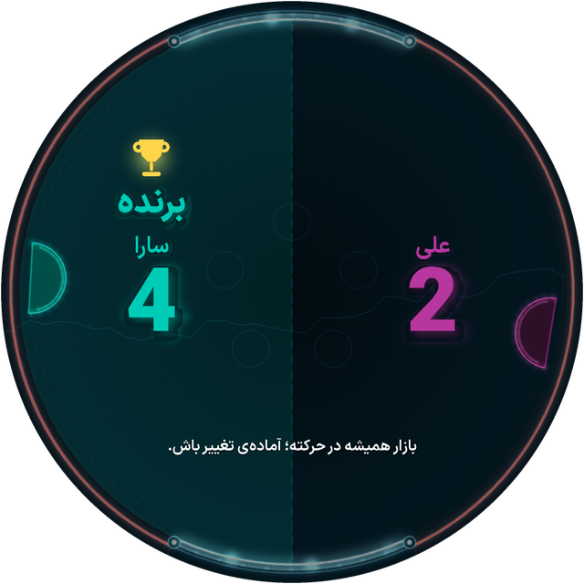
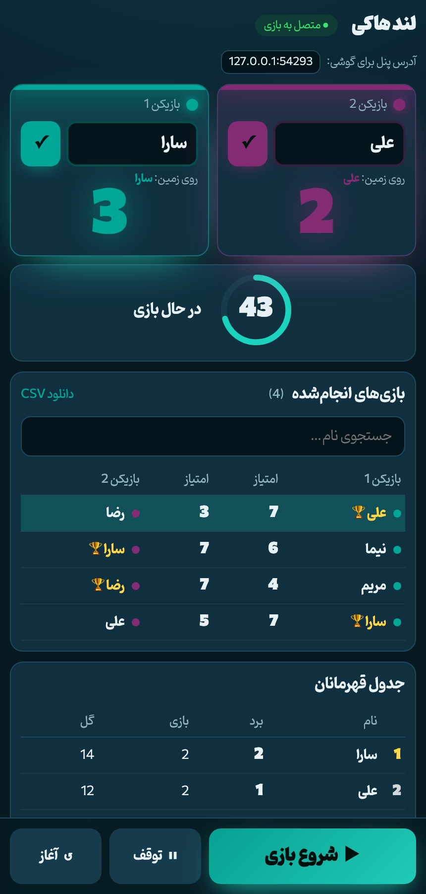
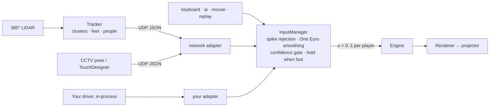

<p align="center"></p>

<p align="center">
  <a href="https://github.com/MML0/mofid-games/actions/workflows/tests.yml"></a>
  <a href="https://github.com/MML0/mofid-games/actions/workflows/build-windows.yml"></a>
  <a href="https://github.com/MML0/mofid-games/releases/latest"></a>
  
  
  
</p>

<p align="center"><b>Air hockey made of light.</b> Two players stand on opposite sides of a glowing circular floor<br>and defend their goals with paddles that follow them, while the market throws everything it has at them.</p>

<p align="center"></p>

<p align="center"><sub>Rendered by the game itself, with no editing. <code>tools/make_readme_media.py</code> makes every picture on this page.</sub></p>

| | | |
|:---:|:---:|:---:|
|  |  |  |
| **Names go up on the floor** | **3, 2, 1, شروع!** | **Star-trail rallies** |
|  |  |  |
| **Multi-ball + market analysis** | **«نوسان ناگهانی بازار!»** | **Crowned on the floor** |

## Why this one is special

- 🎯 **Real physics, not arcade guesses.** A fixed 240 Hz simulation with curved paddles: where the ball lands on the dome decides where it goes. Tests fire it at maximum speed to prove it can never tunnel through a paddle.
- 🪐 **Ten power-ups, each one file.** Orbs drift toward the ball like magnets. The market roulette freezes the ball, spins through possible paths and fires. Drop a new file in a folder and it shows up in the game, the JSON and the control panel.
- 🔤 **Kinetic type backdrop.** A wave of stretching English letters in the brand colors behind the splash, countdown, goals and results, with every slider animated. Preview it with `tools/kinetic_lab.py`; see [the notes](docs/KINETIC_TYPOGRAPHY.md).
- ✈️ **Moving brand objects.** Paper planes, flipping coins, pulsing rings, a dot grid with a heartbeat and a market chart, all made from the brand book's own shapes. They run on the waiting screen and at every big moment.
- 🎛️ **568 settings, all live.** Every speed, color, sound and Persian message has a slider or field, and most change the running game instantly over a local link. Nobody needs to touch code at the exhibition.
- 🌟 **Made for a projector.** Dithered gradients with no banding, supersampled edges, soft additive glow, and a mask that keeps every pixel inside the circle. A test checks that promise frame by frame.
- ✍️ **Persian done properly.** Letters join through HarfBuzz, mixed text stays in the right order, zero-width non-joiners work, and digits stay Latin.
- 📱 **A supervisor page on any phone.** Type the players' names, press start, follow the score, and keep a leaderboard and CSV of everyone who played. It needs no install and no internet.
- 📡 **Sensor-ready.** The game only ever sees "player position along the rim", so keyboard, AI, replay and a 360° LiDAR are interchangeable. [See how](#adding-a-sensor-360-lidar-and-friends).
- 🛡️ **Built not to break mid-show.** 790+ automated tests drag every setting to both extremes, feed the tracker garbage, and corrupt the config file. A bad packet, a broken sensor or a damaged file can't stop the game. [See the tests](#tests).

<p align="center"><br><sub>The supervisor page on a phone (sample names).</sub></p>

## Download

**Windows:** get `MarketHockey-windows.zip` from the [latest release](https://github.com/MML0/mofid-games/releases/latest), unzip it to a writable folder and run `MarketHockey.exe`. Press **Space** to start. A/D and ←/→ move the paddles.

## Quick start

```bash
cd hocky
python3 -m venv .venv
.venv/bin/pip install -r requirements.txt
.venv/bin/python main.py --windowed         # play in a window
.venv/bin/python main.py                    # fullscreen (projector)
.venv/bin/python settings_app.py            # control panel (separate window, live-linked)
.venv/bin/python -m pytest -q               # tests
```

On Windows, use `.venv\Scripts\python` instead of `.venv/bin/python`.
If `pygame-ce` has no wheel for your Python, create the venv with Python 3.12.

## User guide (Persian)

`docs/MarketHockey_Guide_FA.pdf` (راهنمای بازیکن) is a 2-page guide for players covering the goal, the controls and the orbs. To edit it, change `docs/guide/guide_fa.html`, then rebuild the PDF with `.venv/bin/python tools/build_guide.py` (needs Chrome or Edge).

## Design kit (Illustrator)

`design/` holds every visual as editable vectors (SVG + a vector PDF), the palette (.ase), fonts, outlined Persian text and reference screenshots. See `design/README.md` (in Persian). To regenerate it from the current settings, run `python3 tools/export_design_kit.py`.

## Controls

| Key | Action |
|---|---|
| **Space / Enter** | start a match (or skip the result screen) |
| **A / D** | Player 1 (left) paddle: toward *their* left / right |
| **← / →** | Player 2 (right) paddle: toward *their* left / right |
| W/S, ↑/↓ | optional alternates: move the paddles up and down on screen |
| P | pause |
| R (hold ½ s) | reset to the attract screen |
| F1 | open the control panel |
| F2 | projector calibration overlay |
| F4 | open the supervisor web page (player names, start, results, history) |
| F3 | debug overlay (FPS, effects, inputs). While it is on, keys **1–0** spawn power-ups and **B** adds a ball |
| F11 | fullscreen on/off |
| Esc ×2 | quit |

`Display & Projection → Exhibition mode` disables F1–F3 and the debug keys. **Ctrl+Shift+D** still toggles debug.

## The game

- **Arena.** The playfield is a perfect circle inside a square canvas (1080×1080 by default, adjustable). Everything outside the circle is masked to pure black, and a test checks that no pixels leak.
- **Rim.** The rim is split into four arcs:
  - **left arc**: Player 1's red goal line
  - **right arc**: Player 2's red goal line
  - **top and bottom**: solid bumper walls (`walls.top_percent` / `bottom_percent`, % of the circumference). The ball bounces off them and they never score.
- **HUD.** The timer sits just below the top wall. The scores sit just above the bottom wall, P1 on the left and P2 on the right. All digits are Latin.
- **Paddles.** Each paddle is a semicircular dome (flat side to the rim) that slides along the rim, set in by `paddles.p1.rim_padding`.
  - The bounce is physical: the dome's normal decides the outgoing angle, so a hit on the left side of the dome goes to the player's left.
  - `aim_blend` mixes in arcade steering. `max_outgoing_angle_deg` and `min_forward` stop the ball from being sent backward.
- **Scoring.** A ball that crosses the left arc gives P2 a point, and one that crosses the right arc gives P1 a point. The arc decides, not the last touch.
- **Serve.** After a goal, the ball is served **toward the player who conceded**, at a random angle within `serve.angle_variation_deg`.
- **Match end.** The match ends at **60 s or 7 goals**, whichever comes first. Both limits are editable and can be switched off. A tie can end as a draw or go to a golden goal.
- **Trails.** The trail and glow always show **who touched the ball last**. That player collects any power-up the ball passes through. A ball nobody has touched passes through orbs harmlessly.
- **Flow.** Attract demo (AI vs AI) → intro → «آماده‌اید؟» 3‑2‑1 «شروع!» with rings and flashes → play → goal slow-motion → «پایان معاملات!» → winner screen and slogan.

### Power-ups

Green with a solid rim means good for whoever collects it, and red with a dashed rim means it helps the opponent. Each icon pictures its effect. Orbs float in the center slots and are **pulled toward a ball** (aiming where it is about to be). Their hitbox is a bit larger than the drawn orb (`powerups.hitbox_scale`). The magnet is set in `Power-ups → Magnet`: strength, radius, falloff, max drift and return spring.

| | Power-up | Default | Effect |
|---|---|---|---|
| 🟢 | Expand | on | **your** paddle grows (×1.5, 8 s) |
| 🟢 | Shrink | on | **opponent's** paddle shrinks (×0.6, 8 s) |
| 🟢 | Speed up («نوسان بازار») | on | the ball speeds up (×1.4, 6 s) with a flame trail |
| 🟢 | Random path («نوسان ناگهانی بازار») | on | the ball pauses, the event is announced, a roulette of paths spins and locks, and the ball fires. After a short flight it does this once more, unless the ball is already near the receiver. The match timer pauses meanwhile. |
| 🟢 | Double ball («حجم معاملات») | on | a **smaller, slower** second ball appears where the orb was, **half a second later**, so the opponent can handle both |
| 🟢 | Trajectory reveal («تحلیل بازار», 12 s) | on | **you** see where the returning ball will land on your paddle (dotted path, ghost ball, bounce arrow); `beneficiary` can flip it to the opponent |
| 🔴 | Slow down («بازار آرام») | off | the ball slows down |
| 🟢 | Dim ball («اصلاح بازار») | off | the ball dims (never invisible) |
| 🟢 | Shield («حد نوسان») | off | a barrier over your goal blocks one ball |
| 🟢 | Bull market | off | your next goal counts double |

The PDF's match **phases** (no power-ups in the warm-up, more in the peak) and the **Smart Move** («واکنش به‌موقع!»: a fast flick right at contact) are both implemented and configurable.

### Look and feel

- A **faint aim assist** is always on for the receiver. It is a tiny, faint dotted hint near their paddle, a small ghost ball where the ball will land, and a tiny bounce-off arrow. It can be turned off in `Trajectory → Faint aim assist`. The trajectory power-up makes this guide bright and adds the bounce arrow.
- The **comet trail** is built from soft additive glow with star sparkles (`Trails`). Choose `ribbon` for the older look.
- The **walls** are energy barriers with flowing pulses, glowing emitter nodes and a flash when hit (`Arena & Walls`). Choose `classic` for the hatched band.
- **Quality**: the background is a dithered gradient, so it has no banding. The arcs and paddles are drawn supersampled (`display.supersample`), the window is scaled with linear filtering, and text gets a soft shadow and glow.

## Supervisor web page (player names, start, results)

The page starts with the game. Its addresses are **printed in the terminal** at launch, for example:

```
Supervisor page (player names / start / results):
   http://127.0.0.1:8765/   ← this computer
   http://192.168.43.67:8765/   ← phones / tablets on this network
```

Nothing about it is shown on the arena. Open it with **F4**, with the control panel's *Supervisor page ↗* button, or by typing the network address on a phone connected to the same Wi-Fi.

1. Type a player's name and press **Enter** or the small **✓** next to it. It appears on the arena right away. Each player has their own ✓ button.
2. Press **Enter** again, or the big **شروع بازی** (Play) button, and the countdown begins. On a phone, Play, Pause and Reset stay pinned to the bottom of the screen.
3. The page shows the live timer and scores. At the end it shows the winner, the **list of everyone who played** (with search and a CSV download) and a **leaderboard** (wins, games, goals, best score).

Results are saved in `logs/history.jsonl`. To keep the page on this computer only, set `Live Link & Debug → Supervisor web page → Listen on` to `127.0.0.1`.

## Live editing and saving

- Each power-up has its own page in the sidebar (◦ entries under *Power-ups*).
- `settings_app.py` edits **every** setting (568) with sliders, exact-value fields, color pickers, dropdowns and key capture.
- Changes go to the running game **live** over UDP on 127.0.0.1:9201. A green dot means the setting applies live; an orange dot means it applies on restart.
- **Save** (⌘/Ctrl+S) writes `config/settings.json` atomically and keeps `config/settings.prev.json` as a backup. Live edits are *not* saved until you press Save.
- Other tools: **Presets** (`config/presets/*.json`: default, kids_easy, pro, calibration), Revert, Reset to defaults, search (⌘/Ctrl+F) and undo (⌘/Ctrl+Z).
- The right side shows a live layout preview with safe-area warnings, game telemetry, and test buttons (spawn orb, extra ball, debug, calibrate).
- `docs/CONFIG_REFERENCE.md` lists every key with its default and range. Regenerate it with `.venv/bin/python -m market_hockey.config.generate_defaults`.

## Projector calibration

1. Choose the output first. With an LED wall or projector as a second or third screen, set Windows to **Extend** (in Duplicate mode every screen shows the same picture), set `Display & Projection → Display index` to that screen's number (0 is the first) and press **Save**. The game opens fullscreen there. Dragging the window isn't enough: F11 always goes to the `Display index` screen.
2. Run fullscreen on that screen, then press **F2**.
3. Align the thin white circle with the physical circle. Use `arena.mask_radius` and `arena.center_offset_x/y`, or the `display.output_*` scale and offsets.
4. Use `display.rotation` / `flip_h` / `flip_v` for ceiling or rear projection, and `arena.layout_rotation_deg` if the players stand on a different axis.
5. Check the color swatches on the projector and adjust `colors.projection_boost`.

## Persian text

pygame-ce shapes Persian with HarfBuzz (`Font.set_script("Arab")` + RTL direction), so letters join correctly and the zero-width non-joiner (ZWNJ) works. Mixed strings are split into RTL and LTR runs, so Latin digits stay in the right order. Digits are always Latin (۰–۹ are converted). `arabic-reshaper` is the fallback backend (`HUD & Text → Persian shaping`).

To check the rendering, run `.venv/bin/python main.py --selftest-text out/` and look at the PNGs.

Fonts: IRANSansX (copied into `assets/fonts/`). The brand book's primary font, **Dana**, isn't available. Drop `Dana-*.ttf` into `assets/fonts/` and pick it in `HUD & Text → Fonts`.

All in-game texts are editable in `HUD & Text → Messages` and in each power-up's section.

## Adding or removing a power-up

Create one file, `market_hockey/powerups/types/wide.py`:

```python
from ..base import PowerUpType
from ..registry import register

@register
class Wide(PowerUpType):
    id = "wide"; name = "Wide paddle"; order = 11; icon = "expand"
    default_class = "good"; duration = 5.0
    toast_c = "پدل پهن شد!"

    def extra_schema(self, sb, p):
        sb.f(f"{p}.multiplier", 2.0, 1.1, 3.0, 0.1, "×", "Size multiplier")

    def collect(self, engine, ball, collector):
        engine.add_effect(self, self.effect(engine, "paddle_size", ("player", collector),
                                            self.p(engine.cfg, "multiplier"), collector))
        return {"affects": ("player", collector)}
```

It appears in the spawner, the JSON and the control panel automatically.

- **To remove a power-up**, untick *Enabled* (or delete the file).
- **Custom icons**: put `assets/icons/<id>.png` in place to replace the drawn icon.
- **Effect kinds** available to `self.effect(...)`: `paddle_size`, `ball_speed`, `dim`, `reveal`, `shield`, `bull`, `wobble`. Effects are computed from the active list every step, so expiry always restores the previous state.

## Adding a sensor (360° LiDAR and friends)

The engine only consumes *"player position 0..1 along their arc"*, so a sensor is a module you plug in, and nothing else in the game changes. The planned setup is a **360° LiDAR** mounted at the center or overhead, with the detection (clustering, feet, calibration) coming from a separate, proven tracker project.



There are two ways to connect it, and neither touches the engine:

**A. Keep the tracker as its own program (works today).** Set `Inputs → Player 1/2 input` to **network** and send JSON over UDP (default `127.0.0.1:9100`; set *Listen on* to `0.0.0.0` for another machine):

```json
{"type":"tracking","players":[{"id":"p1","x":-0.92,"y":0.20,"conf":0.9},{"id":"p2","x":0.90,"y":-0.10,"conf":0.8}]}
{"type":"blobs","blobs":[{"x":-0.92,"y":0.2},{"x":0.9,"y":-0.1}]}
```

- **Coordinates** are normalized to the arena: center (0,0), rim = 1, +y up. A per-player `"u"` (0..1) skips the mapping.
- **Send one point per person, not per foot.** Blobs are assigned by which goal arc they're on, and the one nearest the rim plays, so two separate feet would make the paddle hop between them. Merge the feet in the tracker.
- **Calibration**: offset, scale, rotation and flip are in `Inputs → Network`, so the sensor can be mounted at any angle.
- **Filters**: One Euro smoothing, spike rejection, confidence gate, hold-when-lost and absent timeout.
- **Test without hardware**: `.venv/bin/python tools/send_fake_tracking.py` (or `--blobs`).

**B. Merge the driver into the game.** Add one file and one line:

```python
# market_hockey/inputs/lidar.py
from .base import InputAdapter, PlayerSample

class LidarAdapter(InputAdapter):
    name = "lidar"
    smooth = True                       # run the sensor filters on this source

    def update(self, now, dt, engine):  # once per frame: read the latest scan; never block
        ...

    def sample(self, idx, now, dt, engine) -> PlayerSample:
        ...                             # u along this player's arc: engine.geom.angle_to_u(idx, angle, width)
```

```python
# market_hockey/inputs/registry.py
ADAPTERS = {..., "lidar": "lidar:LidarAdapter"}
```

That's it. The source appears in the control panel's dropdown, and **`tests/test_input_contract.py` automatically holds it to the rules** every source must follow. If the driver is missing or crashes during a show, that player just reads as absent while the game keeps running.

**Other inputs**: `ai` (single-player vs CPU), `mouse` (debug) and `replay` (record with `input.record`, play back from `input.replay_file`). For CCTV pose (MediaPipe / YOLO-pose), run the model in a separate process and send the ankle midpoint per person, as in route A. From TouchDesigner, use a UDP Out DAT.

## Tests

```bash
.venv/bin/python -m pytest -q                                     # everything, about two minutes
.venv/bin/python -m pytest -q --cov=market_hockey                 # with coverage
.venv/bin/python -m pytest -q tests/test_tracking_protocol.py     # one area
```

Each pull request runs them on Windows and Linux, and the `.exe` is only built if they pass. Coverage below 90% fails the run. Add tests alongside each new module; the sensor and power-up tests below pick new modules up by themselves.

| Area | What it proves | File |
|---|---|---|
| **Every setting** | Every value of every setting applied live mid-match, and random combinations through whole matches, never crash the game or break physics | `test_settings_fuzz.py` |
| **Sensors** | Every registered source obeys the same contract: valid samples, drives the engine, stops cleanly, loads lazily | `test_input_contract.py` |
| **LiDAR path** | A simulated 360° scan → clusters → real UDP → filters → paddles, plus sensor noise, dropouts, mount rotation and 25 kinds of malformed packet | `test_tracking_protocol.py` |
| **Input plumbing** | Routing, crashing or missing sensors, filters, record and replay, keyboard and mouse | `test_input_manager.py`, `test_inputs.py` |
| **Physics** | Direction control, no tunnelling at max speed, never stuck in a paddle, speed stays bounded | `test_physics.py`, `test_geometry.py` |
| **Rules** | Scoring, own goals, serves, golden goal, score and time limits, full match flow | `test_scoring.py`, `test_engine_flow.py` |
| **Power-ups** | All ten types, magnet, stacking, expiry restores state, and new types register themselves | `test_powerups.py` |
| **Long play** | Three minutes of AI vs AI matches with all power-ups on, checking every step | `test_soak.py` |
| **Picture** | No light outside the circle in any state, no banding, every icon draws, Persian shaping, Latin digits | `test_render_units.py`, `test_text_render.py` |
| **Application** | Hotkeys, exhibition lock, panel commands, projector rotation and flip, logs, ports already in use | `test_app.py` |
| **Control panel** | Every page opens, every setting has a control, save, undo, presets, search, live link (driven for real through Tk) | `test_control_panel.py` |
| **Settings files** | Any corrupt or outdated file still starts the game; migrations and atomic saves | `test_config.py`, `test_config_robustness.py` |
| **Supervisor page** | Commands, bad requests, no path traversal, history, CSV for Excel | `test_web.py`, `test_web_robustness.py` |
| **Sound** | Valid generated sounds, the right sound per event, silent without a sound card | `test_audio.py` |
| **What ships** | Presets, defaults and docs are current; assets exist; the build recipe is complete; `core` stays free of UI and sensor code; this README's numbers and links are true | `test_shipped_files.py` |

## Windows build (.exe)

Tagged versions appear under [Releases](https://github.com/MML0/mofid-games/releases) as a zip. GitHub Actions also builds a ready-to-run Windows folder on every push to `main` that touches `hocky/`, after the tests pass. You can also start a build from **Actions → Build Windows → Run workflow**. Download **MarketHockey-windows** from the run's *Artifacts*, unzip it to a writable folder (not *Program Files*), and run `MarketHockey.exe` / `ControlPanel.exe`. Settings, presets and logs are stored next to the `.exe` files.

To build locally on Windows:

```bat
py -3.12 -m venv .venv
.venv\Scripts\pip install -r requirements-build.txt
.venv\Scripts\pyinstaller --noconfirm packaging\MarketHockey.spec
```

Then copy the `config`, `assets` and an empty `logs` folder into `dist\MarketHockey\`. The recipe is `packaging/MarketHockey.spec`. If a packaged run fails, look in `logs/game_crash.log` / `logs/control_panel_crash.log`.

## Tools

- `main.py --screenshot-states DIR`: headless PNGs of every state
- `--export-icons DIR`: power-up badges
- `--selftest-text DIR`: Persian rendering check
- `tools/make_placeholder_sounds.py [--force]`: regenerate the synthesized sound effects
- `tools/make_readme_media.py`: regenerate every picture in the READMEs from the real game (needs `pip install pillow`, ffmpeg and Chrome)
- `tools/send_fake_tracking.py [--blobs]`: pretend to be a LiDAR tracker
- `logs/matches.csv`: one row per match (scores, power-ups, smart hits)
- `logs/market_hockey.log`: the log

## Project layout

```
main.py · settings_app.py · config/ (settings.json, defaults.json, presets/) · assets/ (fonts, sounds, icons)
market_hockey/
  config/      schema.py (every setting), store.py (validation, atomic JSON), live_link.py
  core/        geometry.py, collisions.py, entities.py, engine.py   (pure Python, no pygame)
  powerups/    base.py, registry.py, effects.py, types/*.py         (one file per power-up)
  prediction/  trajectory.py
  inputs/      base.py (the contract), registry.py (every source), keyboard, ai, mouse, network (LiDAR/pose),
               replay, filters, manager
  render/      renderer.py, text.py (Persian), icons.py, glow.py, particles.py, overlays.py
  audio/       synth.py (placeholder sounds), audio.py
  ui/          settings_window.py, widgets.py, preview.py, theme.py
tests/         790+ tests, see "Tests" above
```

## Troubleshooting

- **Persian letters are disconnected**: set `HUD & Text → Persian shaping` to `reshaper`, then run `--selftest-text`.
- **The panel says "Game offline"**: start the game. The panel connects on port 9201 and pushes all its current values.
- **Wrong monitor**: change `display.display_index`, press **Save** and restart. If the number is higher than the screens available, the game opens on the last one.
- **Low FPS**: lower `fx.max_particles`, `trails.glow` or `display.fps_cap`. Use F3 to see the FPS.
- **No sound**: check `Audio → Sound enabled`. The game runs silently if the mixer can't start.
